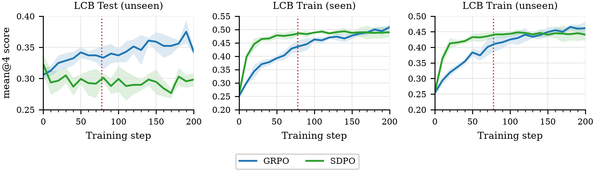

::: {style="display:none"}
$$
\newcommand{\KL}[2]{D_{\mathrm{KL}}\!\left(#1 \,\|\, #2\right)}
\newcommand{\D}[2]{D\!\left(#1 \,\|\, #2\right)}
\newcommand{\sg}[1]{\operatorname{sg}\left(#1\right)}
\newcommand{\argmax}{\operatorname*{arg\,max}}
$$
:::

<hr style="margin-top:-1.5rem">
[This blog post summarizes our paper which will appear at the [Transitioning from Pre-Training to Post-Training](https://pretrain2posttrain.github.io/) workshop at NeurIPS 2026. This is joint work with Ashutosh Sharma, Avinash Balakrishnan, and Rameswar Panda at the [MIT-IBM Computing Research Lab](https://mitibm.mit.edu/); along with Polina Golland and Yoon Kim at [MIT CSAIL](https://www.csail.mit.edu/).]{style="font-size: 0.8em; font-style: italic;"}

[This post focuses on the main results; the paper covers detailed ablations and results across Qwen3 (1.7B–14B) and Olmo-3-7B-Instruct along with our experimental setup; we also provide code to reproduce our results.]{style="font-size: 0.8em; font-style: italic;"}

[<i class="ai ai-arxiv"></i> arXiv](https://arxiv.org/abs/2610.18613){.btn .btn-outline-primary .btn-sm}
[<i class="bi bi-github"></i> Code](https://github.com/sleepypandu/does-sd-improve-reasoning){.btn .btn-outline-primary .btn-sm}

***

[There](https://arxiv.org/abs/2608.01589) [has](https://arxiv.org/abs/2605.22511) [been](https://arxiv.org/abs/2605.17497) [a](https://arxiv.org/abs/2607.28582) [surge](https://arxiv.org/abs/2605.13255) [of](https://arxiv.org/abs/2606.19327) [interest](https://arxiv.org/abs/2604.12002) [in](https://arxiv.org/abs/2608.06296) [the](https://arxiv.org/abs/2605.28791) [self-distillation](https://arxiv.org/abs/2605.12652v2) [paradigm](https://arxiv.org/abs/2609.25623).

::: {.callout-note collapse="false"}
# What is self-distillation?

In typical policy gradient reinforcement learning (e.g., [GRPO](https://arxiv.org/abs/2402.03300)), a model is trained to increase its expected reward, through gradient ascent on $\mathbb{E}_{y\sim \pi_\theta}[R(y)]$. This provides _coarse_ learning signals at the level of entire trajectories $y\sim \pi_\theta$, which might require a large number of samples to learn effectively.

But we know that LLMs generate better solutions when given additional context. Namely, if we tell the model that the last time it tried to solve a task, it triggered `ModuleNotFoundError: No module named 'numpy'`, it probably won't make the same mistake. So, why not train the model to behave _as if it had access to this additional context?_

In self-distillation, this additional context or _privileged information_ can take many forms: reference solutions to math problems, code execution feedback, etc. In practice, in self-distillation we minimize the "difference" between the model's behavior with and without privileged information along trajectories sampled without privileged information. Formally, we write:
$$
\mathcal{L}_{\operatorname{SD}}=\mathbb{E}_{y\sim \operatorname{\sg{\pi_\theta}}}\left[\sum_{t=1}^{|y|} \D{\pi_\theta(y_t|y_{<t})}{\sg{ \pi_\theta(y_t|y_{<t}, z) }}\right],
$$
where $\operatorname{sg}$ is the stop-gradient operator, and $z$ is the privileged information, and $D$ is a choice of information divergence. With $D=D_{\operatorname{KL}}$, $\mathcal{L}_{\operatorname{SD}}$ looks a lot like $\KL{\pi_\theta(\cdot)}{\pi_\theta(\cdot|z)}$.
:::


 [However](https://arxiv.org/abs/2607.01763), [several](https://arxiv.org/abs/2607.05184) [recent](https://arxiv.org/abs/2603.24472) [works](https://arxiv.org/abs/2608.04794) [have](https://arxiv.org/abs/2608.09263) [questioned](https://arxiv.org/abs/2608.18271) [the](https://arxiv.org/abs/2609.20612) [effectiveness](https://arxiv.org/abs/2608.09228) [of](https://arxiv.org/abs/2606.11709) [self-distillation](https://arxiv.org/abs/2604.03128). Self-distillation papers report impressive performance gains which are often hard to replicate. To study why, we carefully reproduce two representative methods, [Self-Distillation Policy Optimization (SDPO)](https://arxiv.org/abs/2601.20802) and [On-Policy Self-Distillation (OPSD)](https://arxiv.org/abs/2601.18734), and study the assumptions underlying self-distillation as presented in [Shenfeld et al](https://arxiv.org/abs/2601.19897). We discover the following:

- **SDPO induces overfitting**, with degraded performance on either new problems or out-of-distribution tasks
- **OPSD does not rely on privileged information**, instead depending on the Qwen3 thinking-mode toggles
- **Self-distillation gradients point the wrong way**, breaking self-distillation assumptions

Together, we believe these findings highlight the need to develop reinforcement learning algorithms that can leverage privileged information to robustly boost performance. _A niche we claim that self-distillation does not fill._


<!--
https://arxiv.org/abs/2601.19897 # SDFT
https://arxiv.org/abs/2601.20802 # SDPO
https://arxiv.org/abs/2601.18734 # OPSD

https://arxiv.org/abs/2608.01589 # PS opsd
https://arxiv.org/abs/2605.22511 # search-E1
https://arxiv.org/abs/2605.17497 # SSOPD
https://arxiv.org/abs/2607.28582 # beta-OPSD
https://arxiv.org/abs/2605.13255 # entropy-guided
https://arxiv.org/abs/2606.19327 # rubric-guided
https://arxiv.org/abs/2604.12002 # self-distillation zero
https://arxiv.org/abs/2608.06296 # OPSD without any supervision
https://arxiv.org/abs/2605.28791 # skill-conditioned OPSD
https://arxiv.org/abs/2605.12652v2 # multirollout
https://arxiv.org/abs/2609.25623 # privileged context design

https://arxiv.org/abs/2607.01763 # denser neq better
https://arxiv.org/abs/2607.05184 # rethinking for thinking models
https://arxiv.org/abs/2603.24472 # sometimes degrade reasoning
https://arxiv.org/abs/2608.04794 # microsoft
https://arxiv.org/abs/2608.09263 # not value
https://arxiv.org/abs/2608.18271 # rethinking PI
https://arxiv.org/abs/2609.20612 # what does PI add
https://arxiv.org/abs/2608.09228 # context induced behavior
https://arxiv.org/abs/2606.11709 # RLCSD: Reinforcement Learning with Contrastive On-Policy Self-Distillation
https://arxiv.org/abs/2604.03128 # Self-Distilled RLVR
-->


## What does self-distillation promise?
Wait; what made self-distillation so appealing to begin with? Let us have a peek at some results and claims made in self-distillation papers.

)](opsd_motivation.png){fig-align="center"}

OPSD claims that having a model internalizing ground truth solutions (via self-distillation), allows it to "teach itself". This contrasts with the standard reinforcement learning paradigm which does learn by trial and error (e.g., GRPO needs both successful and unsuccessful rollouts to learn).

)](sdpo_lcb.png){width=4in fig-align="center"}

SDPO claims to improve over GRPO performance on LiveCodeBench v6, by leveraging the "model's ability to retrospectively identify its own mistakes in-context" and dense logit-level feedback to achieve both sample complexity and performance gains.

)](sdpo_sciknoweval.png){width=7in fig-align="center"}

SDPO claims to demonstrate generalization and wall-clock speedups on hard reasoning tasks, training on science reasoning and tool use tasks.

)](opsd_table2.png){fig-align="center"}

On standard math benchmarks, OPSD claim that the use of privileged information yields consistent performance gains over GRPO, by "utilizing its own rationalization ability to grade its weaker self without access to the ground truth."

This is why self-distillation is appealing: it promises to allow us to use the model's own internalization of environmental feedback to improve itself, instead of relying on external supervision.

### Why might self-distillation work?

)](sdft_icl.png){fig-align="center"}

To justify self-distillation, [Shenfeld et al.](https://arxiv.org/abs/2601.19897) hypothesize that self-distillation works because feeding the model with privileged information (e.g., reference solutions) allows it to approximate the optimal policy 
$$\pi^* = \argmax_\pi \mathbb{E}_{y\sim \pi}[R(y)]-\beta \KL{\pi}{\pi_0}.$$

And indeed! We show in Proposition 3.1 of [our paper](https://arxiv.org/abs/2610.18613) that if $\pi_\theta(\cdot|z)=\pi^*(\cdot)$, then **self-distillation is equivalent to _directly performing gradient ascent on the expected reward_.** Under this assumption, self-distillation should maximize the same objective as GRPO, just with better sample efficiency afforded by dense logit-level feedback.

## How the cookie crumbles
Well? How well does this assumption hold? How well do self-distillation gradients align with reward maximization gradients? We measure exactly this.

| Method | Qwen3-8B | Qwen3-14B | Olmo-3-7B-Instruct |
|---|---|---|---|
| GRPO | **+0.121** | **+0.070** | **+0.422** |
| SDPO | −0.167 | +0.013 | +0.062 |

: Cosine similarity between training gradients and the test-set reward maximization gradient on LiveCodeBench v6 {.striped .hover}

| Method | Qwen3-1.7B | Qwen3-4B | Qwen3-8B | Qwen3-14B | Olmo-3-7B-Instruct |
|---|---|---|---|---|---|
| GRPO | **+0.018** | **+0.060** | **+0.118** | **+0.166** | +0.026 |
| OPSD | −0.205 | −0.132 | −0.160 | −0.075 | **+0.057** |

: Cosine similarity between training gradients and the test-set reward maximization gradient on AIME24, AIME25, and HMMT 25 {.striped .hover}

This seems to indicate that by and large^[Olmo-3-7B-Instruct OPSD numbers do not clearly resolve above 0 after estimating measurement errors through 4 seeds runs], self-distillation gradients are orthogonal or even anti-aligned with the reward maximization gradient. By a Taylor series argument, with small enough steps, _following the self-distillation gradient will not improve the expected reward, and may even hurt it._

Wait, so how do you explain the previously reported performance gains?

### Overfitting abounds
Note the following excerpt from page 8 of the [SDPO](https://arxiv.org/abs/2601.20802) paper:

> We consider a setting with public and private unit tests, common for code contests and coding platforms like LeetCode, where the public tests are used for evaluation during training and the private tests are used for validation.

In other words; _SDPO evaluates on the same LiveCodeBench v6 problems it trains on_, doing train-test splitting only across unit tests. Doing proper train-test splitting across problems yields the following curves:

{fig-align="center"}

We see that although SDPO learns faster than GRPO on the training set (on both seen and unseen unit tests), it _overfits to the training problems_, and performs worse than GRPO on unseen problems. Moreover, training for longer than ~80 steps (marked in red) as SDPO does, shows that GRPO beats even SDPO on the training problems given enough time.

How about SDPO's reported gains on science reasoning and tool use tasks?

| | Biology | Chemistry | Material | Physics | Tool use | Avg |
|---|---|---|---|---|---|---|
| SDPO | **52.5** | **77.7** | 73.5 | **73.1** | 53.5 | 66.1 |
| GRPO | 51.0 | 68.9 | **76.2** | 72.4 | **66.3** | **67.0** |

: In-domain accuracy Qwen3-8B after 200 steps, by training domain {.striped .hover}

| | Biology | Chemistry | Material | Physics | Tool use | Avg |
|---|---|---|---|---|---|---|
| SDPO | −12.8 | −16.6 | −7.1 | −12.5 | **+0.9** | −9.6 |
| GRPO | **+1.2** | **+1.6** | **+1.2** | **+0.9** | −2.1 | **+0.6** |

: OOD change (mean accuracy change over all non-training domains) of Qwen3-8B after 200 steps, by training domain {.striped .hover}

We find that although SDPO and GRPO perform similarly on the training domains, SDPO _degrades_ performance on out-of-distribution domains, consistent with the overfitting hypothesis.

### Unprivileged information
Recall that OPSD claims that it works by "exploit[ing] the ground-truth solution $y^*$ directly as privileged information during training, enabling the model to serve as its own teacher". But a careful reading of OPSD reveals that the OPSD teacher differs from its student in _two_ ways: the teacher sees the reference solution, _and_ the teacher has Qwen3's thinking mode turned on, while the student has it turned off. Moreover, note that they also report validation performance with _thinking mode turned on_.

So which one matters? We find that really, it doesn't matter what $y^*$ you feed into the model; you can feed a random solution or no solution at all, and OPSD performance is largely unchanged and even improves in some cases.

::: {style="font-size: 100%;"}
| Method | AIME24 | AIME25 | HMMT25 | Avg |
|---|---|---|---|---|
| Base | 75.6 | 68.6 | 45.0 | 63.1 |
| OPSD, ref $z$ | 77.2 | **71.6** | 46.4 | 65.0 |
| OPSD, no $z$ | 78.1 | 71.0 | **46.7** | **65.3** |
| OPSD, shuffled $z$ | **78.3** | 71.2 | 45.9 | 65.1 |

: Thinking-on accuracy of Qwen3-8B; $z$ denotes the reference solution for the OPSD teacher, with teacher thinking on during OPSD training {.striped .hover tbl-colwidths="[24,14,14,14,14]"}
:::

Note that these thinking-on gains are small to begin with. The difference becomes much clearer when we evaluate with thinking off, the same mode the student is trained in:

| | Ref $z$ | No $z$ | Shuffled $z$ |
|---|---|---|---|
| OPSD (teacher think) | 33.1 | **44.6** | 33.2 |
| OPSD (teacher no think) | 19.5 | 20.4 | 19.1 |

: Average thinking-off accuracy (AIME24, AIME25, HMMT25) of Qwen3-8B; the base model scores 19.3 {.striped .hover}

Turning on teacher thinking improves thinking-off accuracy by 17.3 points on average, while swapping in the reference solution of a different problem changes it by at most 0.4 points. Without teacher thinking, OPSD barely improves over the base model at all.

We find by looking at the generations, thinking-off students trained with a thinking teacher learn to _think anyway_ breaking their non-thinking mode, and this is what leads to performance improvements. _OPSD's gains come from leaking thinking-mode behavior into the non-thinking mode_, which requires no privileged information at all.

## Conclusion
So, does self-distillation improve reasoning? Not in the way it promises to.

Self-distillation was supposed to let a model _teach itself_, turning privileged information into a dense, sample-efficient learning signal. Instead, we find that its reported gains either don't generalize, or don't come from privileged information at all:

- **SDPO** improves on the problems it trains on, at the cost of new problems and other domains
- **OPSD** gains just as much or more when the reference solution is shuffled or removed; what it really transfers is thinking-mode behavior
- **Both** produce gradients that largely point away from reward maximization on held-out problems

We hope that this work encourages algorithmic development of reinforcement learning methods that actually leverage privileged information to yield robust performance gains.

## BibTeX
If you found this work useful, please cite it as follows:
```bibtex
@misc{adhinarta2026selfdistillation,
      title={Does self-distillation improve reasoning?}, 
      author={Jason Ken Adhinarta and Raina Wu and Ashutosh Sharma and Avinash Balakrishnan and Rameswar Panda and Polina Golland and Yoon Kim and Zhang-Wei Hong},
      year={2026},
      eprint={2610.18613},
      archivePrefix={arXiv},
      primaryClass={cs.LG},
      url={https://arxiv.org/abs/2610.18613}, 
}
```
